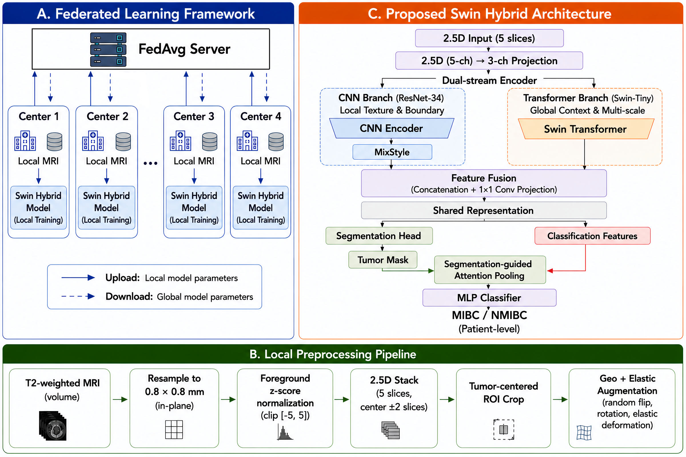

# Federated Multi-Task Learning for Bladder Tumor Segmentation and MIBC Classification

Research code for the accepted paper _"Federated Multi-Task Learning for
Bladder Tumor Segmentation and MIBC Classification Using a Hybrid
CNN-Transformer Architecture"_.

> This repository contains research code only. It does not distribute medical
> data and does not provide clinical diagnosis. The FedBCa dataset must be
> obtained separately and used according to its applicable terms.

---

## 1. Overview

Bladder cancer staging turns on whether a tumour has invaded the muscle layer
of the bladder wall: muscle-invasive bladder cancer (MIBC) is managed
differently from non-muscle-invasive disease (NMIBC). Both the tumour's extent
and its relationship to the bladder wall are visible on T2-weighted MRI, which
makes segmentation and staging two views of the same anatomy rather than two
unrelated problems.

Training a model that does both well needs data from several hospitals, and
patient data cannot be pooled across them. This repository implements a
**federated multi-task framework** that addresses both constraints: a single
network predicts the tumour mask and the MIBC/NMIBC label from a shared
representation, and it is trained across **four clinical centres** with
**FedAvg**, so only model parameters are ever exchanged.

The proposed **Swin Hybrid** model pairs a **ResNet-34** branch, which captures
local texture and boundary detail, with a **Swin-Tiny** Transformer branch,
which captures global anatomical context. Its classification branch is
**segmentation-guided**: the predicted tumour map (detached, so no
classification gradient flows back through it) pools the deepest Transformer
feature, which keeps the staging decision anchored to the predicted tumour
region rather than to background bladder wall.

Among seven augmentation strategies evaluated under both centralised and
federated training, **Geo+Elastic** is the selected final strategy.

This is a research framework for automated analysis and prediction. It is not
a clinical tool and is not a substitute for a clinician's assessment.

## 2. Key contributions

- **Federated multi-task framework.** FedAvg over four heterogeneous clinical
  centres, jointly optimising tumour segmentation and MIBC classification
  without sharing patient data.
- **Swin Hybrid architecture.** A dual-stream encoder combining a pretrained
  ResNet-34 CNN branch with a Swin-Tiny Transformer branch, connected to a
  segmentation-guided attention mechanism for classification.
- **Augmentation study for scanner heterogeneity.** A systematic comparison of
  augmentation strategies under both centralised and federated training,
  identifying elastic deformation combined with geometric transforms as the
  strategy that best survives the move to federated training.

## 3. Architecture



```
FedBCa MRI
  -> client-side preprocessing
  -> 2.5D five-slice MRI input
  -> input adapter (5 -> 3 channels)
  -> dual-stream Swin Hybrid encoder
       |- ResNet-34 CNN branch      -> local texture / boundary features
       |- Swin-Tiny Transformer     -> global anatomical context
  -> feature fusion
  -> shared multi-task representation
       |- tumour segmentation       -> attention-gated decoder, deep supervision
       |- segmentation-guided classification -> MIBC / NMIBC
  -> local training at each medical center
  -> FedAvg
  -> global federated model
```

Figure 1 of the paper: the federated framework (A), the Swin Hybrid architecture
(C) and the local preprocessing pipeline (B).

## 4. Dataset

FedBCa: **275 T2-weighted MRI scans** from **four medical centres**, each with
a pixel-level tumour segmentation mask and a pathological MIBC/NMIBC label.

| Centre    | Scans   | NMIBC   | MIBC   |
| --------- | ------- | ------- | ------ |
| Center 1  | 160     | 130     | 30     |
| Center 2  | 48      | 23      | 25     |
| Center 3  | 32      | 19      | 13     |
| Center 4  | 35      | 18      | 17     |
| **Total** | **275** | **190** | **85** |

The dataset is **not** included in this repository. See
[`docs/DATASET.md`](docs/DATASET.md) for how to obtain it and the directory
layout the code expects.

## 5. Preprocessing

Run at each centre, on that centre's own data:

1. reorientation to RAS and in-plane resampling to 0.8 x 0.8 mm (B-spline for
   the image, nearest neighbour for the mask);
2. foreground thresholding (5th percentile), clipping to the 0.5th-99.5th
   foreground percentiles, Z-score normalisation and clipping to [-5, 5];
3. 2.5D construction: each target slice is stacked with the two slices above
   and the two below, giving a five-channel input;
4. tumour-centred ROI crop, resized to the fixed 224 x 224 model input of the
   Swin Hybrid.

Optional N4 bias-field correction is implemented but disabled by default
(`apply_n4: false`); it is not part of the pipeline described in the paper.

Exact values are in `configs/preprocessing.yaml`. The paper mentions 256 x 256
inputs for the CNN pathway and 224 x 224 for the Swin pathway; the code feeds one
tensor to both branches, at `input_size` (224 by default). See
[`docs/PAPER_CODE_AUDIT.md`](docs/PAPER_CODE_AUDIT.md).

## 6. Model

| Component           | Implementation                                              |
| ------------------- | ----------------------------------------------------------- |
| Input               | 2.5D stack, 5 channels, 224 x 224                           |
| Input adapter       | 1x1 convolution, 5 -> 3 channels, mean-initialised          |
| CNN branch          | ImageNet-pretrained ResNet-34, frozen BatchNorm, MixStyle   |
| Transformer branch  | ImageNet-pretrained Swin-Tiny                               |
| Fusion              | concatenation + 1x1 projection of the intermediate features |
| Segmentation head   | attention-gated decoder with deep supervision at two depths |
| Classification head | segmentation-guided attention pooling + MLP                 |
| Objective           | `L = 0.80 L_seg + 0.20 L_cls`                               |

`L_seg` combines Dice, binary cross-entropy, Focal Tversky and a boundary term,
plus the auxiliary deep-supervision terms. `L_cls` is a focal cross-entropy,
ramped in over the first cumulative training epochs so that the segmentation
branch stabilises first.

The centralized training implementation applies the documented 20-epoch
classification-loss ramp. The released federated client preserves the fixed
classification-loss weighting used by the archived federated implementation;
this difference is documented in `docs/PAPER_CODE_AUDIT.md`.

## 7. Federated learning

| Setting                | Value                             |
| ---------------------- | --------------------------------- |
| Clients                | 4, one per clinical centre        |
| Participation          | all four clients in every round   |
| Local epochs per round | 3                                 |
| Communication rounds   | 50                                |
| Aggregation            | sample-size-weighted FedAvg       |
| Model selection        | highest validation combined score |

Only model parameters cross the network; images, masks and labels stay at the
centre that holds them.

## 8. Training

```bash
python scripts/train.py --config configs/swin_hybrid.yaml \
    --augmentation geo_elastic
```

AdamW with a warmup-cosine schedule, base learning rate 2e-5, branch
multiplier of 0.30 for the Swin-Tiny branch (the ResNet-34 branch trains at the
base rate, as in the recorded runs; see the audit), weight decay 1e-4,
gradient clipping at max norm 1.0, and an effective batch size of 24 reached
with gradient accumulation. The pipeline is script-first; no notebook is
needed to run it.

## 9. Evaluation

- **DSC** - Dice Similarity Coefficient, on slices with a non-empty
  ground-truth tumour mask.
- **AUC** - at the patient level, after averaging the slice-level MIBC
  probabilities of each patient.
- **Combined score** - `S_comb = 0.55 * DSC + 0.45 * AUC`, used for model
  selection; DSC and AUC are reported separately.

```bash
python scripts/evaluate.py --config configs/swin_hybrid.yaml \
    --checkpoint outputs/swin_hybrid_geo_elastic/checkpoint_best.pt \
    --split test --per-center
```

## 10. Results

All numbers are those reported in the accepted paper. See
[`results/`](results/) for the CSV files and the full tables.

**Centralised architecture comparison**

| Model                      | DSC        | AUC        | Combined   |
| -------------------------- | ---------- | ---------- | ---------- |
| ResNet50 U-Net             | **0.8181** | 0.8304     | 0.8236     |
| EfficientNet-B0 U-Net      | 0.7669     | 0.7589     | 0.7633     |
| ResNet50+CBAM              | 0.7579     | 0.7232     | 0.7423     |
| Multi-task EfficientNet-B0 | 0.7653     | 0.7679     | 0.7664     |
| **Swin Hybrid (proposed)** | 0.8088     | **0.9286** | **0.8627** |

The Swin Hybrid gives the best patient-level AUC and combined score; the
single-task ResNet50 U-Net has the highest DSC. The Swin Hybrid was taken
forward to the augmentation study.

**Augmentation comparison (Swin Hybrid)**

| Augmentation       | Cen. DSC   | Cen. AUC   | Cen. Comb. | Fed. DSC   | Fed. AUC   | Fed. Comb. |
| ------------------ | ---------- | ---------- | ---------- | ---------- | ---------- | ---------- |
| None               | 0.8088     | **0.9286** | 0.8627     | 0.7908     | 0.7716     | 0.7822     |
| GIN Only           | 0.8161     | 0.8750     | 0.8426     | 0.7790     | 0.7270     | 0.7560     |
| Augmentation Stack | **0.8487** | 0.8661     | 0.8565     | **0.8220** | 0.8230     | 0.8225     |
| **Geo+Elastic**    | 0.8272     | 0.9196     | **0.8688** | 0.8100     | **0.8931** | **0.8474** |
| Geo+Bias           | 0.8391     | 0.8661     | 0.8513     | 0.8094     | 0.8414     | 0.8238     |
| Geo+Gamma          | 0.8417     | 0.8750     | 0.8567     | 0.7987     | 0.8575     | 0.8252     |
| Geo+Noise          | 0.8398     | 0.8750     | 0.8556     | 0.8108     | 0.8240     | 0.8167     |

Table values are copied from the paper; their provenance is discussed in
[`docs/PAPER_CODE_AUDIT.md`](docs/PAPER_CODE_AUDIT.md) (item 9). Under federated
training, Geo+Elastic reaches a DSC of 0.8100 and a
patient-level AUC of 0.8931, for the highest combined score of 0.8474.

## 11. Repository structure

```
FedBCa-SwinHybrid-CVIP/
├── README.md
├── requirements.txt
├── .gitignore
│
├── configs/
│   ├── preprocessing.yaml       Preprocessing parameters
│   ├── swin_hybrid.yaml         Centralised training
│   └── federated.yaml           Federated training
│
├── src/
│   ├── models/                  Swin Hybrid and its building blocks
│   ├── datasets/                FedBCa dataset and dataloaders
│   ├── preprocessing/           N4, resampling, normalisation, 2.5D stacking
│   ├── augmentation/            The seven augmentation strategies
│   ├── losses/                  Joint multi-task objective
│   ├── metrics/                 DSC, patient-level AUC, combined score
│   ├── federated/               Flower client and FedAvg server
│   ├── training/                Centralised training engine
│   └── utils/                   Configuration loading and path resolution
│
├── scripts/
│   ├── preprocess.py            Raw MRI -> 2.5D slice tensors
│   ├── make_splits.py           Patient-level stratified splits
│   ├── train.py                 Centralised training
│   ├── evaluate.py              Checkpoint evaluation
│   ├── federated_server.py      FedAvg server
│   └── federated_client.py      One client, centre given by --center
│
├── docs/                        Dataset, reproducibility, paper-code audit
```

## 12. Installation

Python 3.10 or newer, and a CUDA-capable GPU for training.

```bash
git clone <repository-url>
cd FedBCa-SwinHybrid-CVIP

python -m venv .venv
source .venv/bin/activate          # Windows: .venv\Scripts\activate

pip install -r requirements.txt
```

Install the PyTorch build that matches your CUDA driver; no CUDA-specific
version is pinned here. Pretrained ResNet-34 and Swin-Tiny weights are fetched
by `timm` on first use, so the first run needs network access.

## 13. Usage

```bash
# Where your copy of the data lives, and where outputs should go.
export FEDBCA_ROOT=/path/to/FedBCa
export FEDBCA_PREPROCESSED=/path/to/preprocessed
export FEDBCA_SPLITS=/path/to/splits
export FEDBCA_OUTPUT=/path/to/outputs

# 1. Preprocess, then build patient-level splits.
python scripts/preprocess.py --config configs/preprocessing.yaml
python scripts/make_splits.py \
    --slice-index $FEDBCA_PREPROCESSED/slice_index.csv \
    --output-dir $FEDBCA_SPLITS

# 2. Train centrally with the selected augmentation.
python scripts/train.py --config configs/swin_hybrid.yaml \
    --augmentation geo_elastic

# 3. Evaluate on the held-out test split.
python scripts/evaluate.py --config configs/swin_hybrid.yaml \
    --checkpoint $FEDBCA_OUTPUT/swin_hybrid_geo_elastic/checkpoint_best.pt \
    --split test --per-center
```

Every path is a configuration key or a flag, so a fresh clone runs on another
Linux machine without editing any Python source.

## 14. Federated training

Start the server, then one client per centre, each in its own terminal:

```bash
python scripts/federated_server.py --config configs/federated.yaml

python scripts/federated_client.py --center 1
python scripts/federated_client.py --center 2
python scripts/federated_client.py --center 3
python scripts/federated_client.py --center 4
```

There is one client implementation; the centre is a command-line argument, and
each client reads only its own centre's slices. Clients may run on separate
machines by pointing `--server-address` at the server's host and port. The
server writes `round_metrics.csv` and keeps the best global model as
`global_model_best.npz`, which `scripts/evaluate.py` reads directly.
